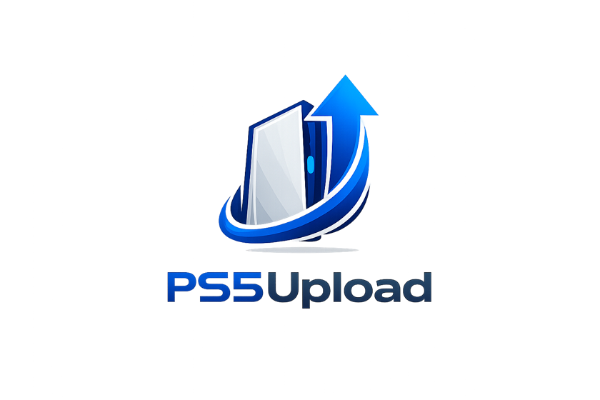

# ps5upload

<p align="center">
  <picture>
    <source media="(prefers-color-scheme: dark)" srcset="branding/png/lockup-horizontal-white.png" />
    
  </picture>
</p>

<p align="center">
  PS5 Upload gets your games, apps and homebrew onto a jailbroken PS5 quickly and reliably: uploads resume after a dropped connection, installs pick the route that works, and you can browse files, manage the console and run cheats from your computer, phone or browser.
</p>

<p align="center">
  <a href="https://github.com/phantomptr/ps5upload/releases"></a>
  <a href="LICENSE"></a>
  
  
  <a href="https://discord.gg/fzK3xddtrM"></a>
</p>

---

## What it does

- **Fast, resumable uploads** of games, folders, disk images and `.zip` / `.7z` / `.rar`
  archives (unpacked on the way, nothing extracted to your disk). Everything runs over
  **AVA1**, one encrypted connection on port 9120. Every file is verified, and an upload
  continues after a dropped connection, a helper restart or rest mode. A job that will not
  fit is refused up front, counting what is already on the console. Queue, live speed and ETA.
- **Upload & Install.** One drop zone takes packages, game folders and dumps, disk images,
  archives and any other file, and works out what each is. PS4 `.pkg` and PS5 fake packages
  (base, update, DLC) install from your computer (**Stream & install** or **Upload & install**),
  a NAS/SMB share, a USB drive or a link. If the PS5 refuses one route, the app offers another.
  PS5 fake packages install but do not start on firmware later than 11.60; PS4 fake packages
  are fine.
- **Games.** One grid with every game once: your copies in your folders (including folders on
  a NAS, scanned in place) grouped with their updates and DLC, what each PS5 has installed, and
  the games on its drives. Play (or close) an installed game right from its card. Each game's
  page holds everything you can do with it: install, play, mount, add to the home screen, move,
  back up, convert, dump. Organize, de-duplicate and clean up the
  drives. Replaces PS Game Library.
- **Convert games (Workshop).** Build an installable package from a decrypted game folder or an
  image, or write a game folder as a game image (`.exfat`, `.ffpkg`, `.ffpfs`, or the smaller
  `.ffpfsc`) that ShadowMount+ mounts. A queue makes games one after another and hands each to
  Upload & Install to install or upload.
- **Browse and manage.** Files, games, disk images (mount, edit in place), saves, screenshots
  and video clips; share a save with a friend (it loads on their PS5 as their own); register, launch, stop and uninstall games; copy, move (Move to…),
  delete, set permissions.
- **Remote Play.** Play the PS5 from your computer, phone or browser, no PS Remote Play app
  needed:
  - Start wakes a console in rest mode and signs your user in; the stream keeps playing while
    you use other screens, and a dropped connection rejoins by itself.
  - Play with a controller connected to this device, the keyboard (keys you can remap) or an
    on-screen controller on phones and tablets; the controller vibrates with the game.
  - Picture in picture: a small always-on-top window while you do something else (desktop app,
    Chrome and Edge; picture only in Safari).
  - 1080p or 720p at 60 or 30 fps, full screen, volume, stats on the picture, and low-delay
    sound.
  - A step-by-step setup in Accounts that checks each requirement on the console and fixes what
    it can (sign-in, account ID, Remote Play switches, pairing), plus a PIN for Sony's PS Remote
    Play app or chiaki-ng if you prefer those.
- **Cheats, fan curve, hardware view,** payload sender with a catalogue and playlists, and
  backport tools.
- **Power.** Rest mode, reboot, shut down, and wake over the network (optionally straight
  into your signed-in user).
- **PS5Upload Minion.** A page the helper serves to the PS5's own browser (a tile on the home
  screen, port 9180), made for the controller: installed games and the games on your network
  shares and drives, save backups, files (SMB shares, archive extraction, package install,
  payload loading), cheats, fan, processes, clean-up and settings, with no PC nearby.
- **Several devices, one PS5.** Computers, phones and Docker connect at once with no pairing
  code, see what the others are doing (Devices), share your consoles and settings, and stay out
  of each other's way. Settings are backed up daily, to the engine and to each console.
  **Mesh Drive** keeps a folder the same on all of them, at home on the
  console, with an optional join password and every device's state visible from any of them.
- **Runs everywhere:** macOS, Windows, Linux, Android, iPhone (sideloaded), or any browser through the self-hosted
  Docker web UI ([compose file](engine/compose.yaml), see
  [Self-hosted engine and web UI](#self-hosted-engine-and-web-ui)). 21 languages.

## What it doesn't do

- **System package patches** (NPXS Store or Settings updates). Use the PS5's own
  Settings → Debug Settings → Game → Package Installer.
- **Sign packages with fake keys.** It only installs packages the console already trusts.

## A quick look


## Install

Pre-built downloads land on the
[Releases page](https://github.com/phantomptr/ps5upload/releases):

| Platform | File | How to install |
|---|---|---|
| macOS (Apple Silicon / Intel) | `PS5Upload-<ver>-mac-{arm64,x64}.dmg` | Open the `.dmg`, drag PS5Upload into Applications. See **First launch on macOS** below — Gatekeeper blocks downloaded apps the first time. |
| Windows (x64 / ARM64) | `PS5Upload-<ver>-win-{x64,arm64}-setup.exe` or `PS5Upload-<ver>-win-{x64,arm64}.zip` | Run the `-setup.exe` installer (it updates itself later), or unzip the `.zip` and double-click `PS5Upload.exe` — portable, no installer. See **First launch on Windows** — SmartScreen warns on first run. |
| Linux — Debian / Ubuntu (x64 / ARM64) | `PS5Upload-<ver>-linux-{x64,arm64}.deb` | `sudo apt install ./PS5Upload-<ver>-linux-<arch>.deb` — installs a normal app with a menu entry; pulls in the WebKitGTK deps automatically. |
| Linux — Fedora / RHEL / Bazzite (x64 / ARM64) | `PS5Upload-<ver>-linux-{x64,arm64}.rpm` | `sudo dnf install ./PS5Upload-<ver>-linux-<arch>.rpm` (Bazzite/Silverblue: `rpm-ostree install`; to update, `rpm-ostree uninstall ps5-upload --install ./<new>.rpm` and reboot, which Settings → Updates shows ready to copy) — menu entry + auto deps. |
| Linux — any distro (x64 / ARM64) | `PS5Upload-<ver>-linux-{x64,arm64}.zip` | Universal fallback (no install). Unzip, then `chmod +x PS5Upload.sh PS5Upload.AppImage` and run **`./PS5Upload.sh`** (the wrapper — handles the FUSE-less and WebKit white-screen cases for you). Running `./PS5Upload.AppImage` directly also works if your system has libfuse2 and a happy WebKitGTK. |
| Linux — AppImage (x64 / ARM64) | `PS5Upload-<ver>-linux-{x64,arm64}.AppImage` | The bare AppImage, for AppImage managers (Gear Lever, AppImageLauncher). `chmod +x` and run it. On Wayland with an NVIDIA card it restarts itself once with the system `libwayland-client`, which is what the `.zip`'s `PS5Upload.sh` does. |
| Linux — NixOS (x64 / ARM64) | no release artifact | Packaged in [NUR](https://github.com/GriefNorth/nur-packages) as `ps5upload` — see **NixOS** below. |
| Android | `PS5Upload-<ver>-android.apk` (older 32-bit phones: `-android-armv7.apk`) | Enable "install unknown apps" for your browser/file manager, then open the `.apk`. Same interface, mobile-friendly; connects to and manages your PS5 over Wi-Fi. On Android 17, allow local network access ("nearby devices") when asked. |
| iPhone | `PS5Upload-<ver>-ios-unsigned.ipa` | Sideload with AltStore or Sideloadly and an Apple ID (a free one works; it is re-signed every 7 days). AltStore, SideStore and Feather can also add the source `https://github.com/phantomptr/ps5upload/releases/latest/download/altstore.json` and update the app from there. Turn on Developer Mode and trust your Apple ID on the iPhone; see the FAQ. Copy games into the app's folder with the Files app. |

### NixOS

No NixOS artifact is published on the Releases page, but ps5upload is
packaged in [GriefNorth's NUR](https://github.com/GriefNorth/nur-packages) as
`ps5upload` (x64 and ARM64) — it wraps the same `.AppImage` and needs no
FUSE. With flakes:

```nix
{
  inputs = {
    nixpkgs.url = "github:NixOS/nixpkgs/nixos-unstable";
    nur.url = "github:GriefNorth/nur-packages";
  };

  outputs = { nixpkgs, nur, ... }: {
    nixosConfigurations.myhost = nixpkgs.lib.nixosSystem {
      system = "x86_64-linux";
      modules = [
        ({ pkgs, ... }: {
          environment.systemPackages = [
            nur.packages.${pkgs.system}.ps5upload
          ];
        })
      ];
    };
  };
}
```

Then `nixos-rebuild switch --flake .#myhost` and launch **ps5upload** from
your app menu. Without flakes, call the package straight out of the repo —
and note that ps5upload bundles UnRAR for `.rar` support, so nixpkgs needs
`config.allowUnfree = true`:

```nix
{ pkgs, ... }:
{
  nixpkgs.config.allowUnfree = true;

  environment.systemPackages = [
    (pkgs.callPackage
      ((builtins.fetchTarball
        "https://github.com/GriefNorth/nur-packages/archive/refs/heads/main.tar.gz")
        + "/pkgs/ps5upload")
      { })
  ];
}
```

Or try it without installing anything:

```bash
nix run github:GriefNorth/nur-packages#ps5upload
```

The Nix expression pins one release version, so bump it there when a new
ps5upload comes out. Prefer to run the AppImage yourself? Prefer the
`./PS5Upload.sh` wrapper from the zip above — on NixOS the bare
`.AppImage` usually renders an empty window, because its bundled
`libwayland-client` shadows the host one and WebKitGTK then fails to create
an EGL display. The Nix package works around that for you.

### First-launch warnings (and why they're there)

ps5upload is not code-signed with paid OS certificates — same as
every other PS5 scene tool. The OS's verification layers
(Gatekeeper on macOS, SmartScreen on Windows) treat unsigned downloads
as suspicious until you allow them once. The one-time bypass:

**macOS** — "App is damaged" or "cannot be opened":
```bash
xattr -dr com.apple.quarantine /Applications/PS5Upload.app
```
That removes the *quarantine* attribute macOS slaps on every file
downloaded from a browser. Alternatively, right-click PS5Upload in
Applications → **Open** → click **Open** in the prompt. Either method
only needs to be done once per install.

**Windows** — "Windows protected your PC" SmartScreen prompt:
- Click **More info** → **Run anyway**.
- Only shown until SmartScreen builds reputation for the binary;
  subsequent launches are silent.
- If your IT policy blocks "Run anyway", unzip + right-click
  `PS5Upload.exe` → **Properties** → check **Unblock** → **OK**.

**Linux** — no equivalent warning. Just `chmod +x` and launch.

### System requirements

- **macOS** 11 (Big Sur) or newer. No dependencies — ad-hoc signed,
  see *First launch* above for the one-line quarantine bypass.
- **Windows** 10 (build 19041+) or Windows 11. Ships with the
  Microsoft Edge WebView2 runtime by default; LTSC / stripped
  installs may need
  [WebView2](https://developer.microsoft.com/microsoft-edge/webview2/)
  installed once.
- **Linux** — the `.deb` and `.rpm` packages **pull in their
  dependencies automatically** (WebKitGTK 4.1, gtk3, libsoup3, etc.) via
  the package manager, so they're the easiest route on Debian/Ubuntu and
  Fedora/RHEL/Bazzite. The universal `.AppImage` instead expects those
  libraries already on the host (libfuse2, gtk3, webkit2gtk 4.1,
  libsoup3, libappindicator, librsvg2); install commands for
  Debian/Ubuntu/Fedora/RHEL/Arch are in
  [the FAQ](FAQ.md#prerequisites).
  **Minimum distro version:** all three Linux artifacts are built against
  **glibc 2.39**, so they need a reasonably recent distro — **Ubuntu
  24.04+, Debian 13+ (trixie), Fedora 40+**, or equivalent. (This is a
  glibc floor, not a package dependency — the `.deb`/`.rpm` install fine
  on older releases but the app won't launch, and the AppImage bundles
  WebKitGTK yet still uses the host's glibc.) On an older distro, build
  from source with `make dist-linux` on that machine.

The app checks GitHub for updates once per launch (Settings → Updates)
and downloads a fresh archive to your Downloads folder when you click
Download. Replace the old app and relaunch; the app then offers to update the helper.

Building from source:

```bash
git clone --recurse-submodules https://github.com/phantomptr/ps5upload.git
cd ps5upload
make install       # bootstrap dev env (auto-detects host OS)
make build         # payload ELF + engine + client UI
make run-client    # launch the Tauri dev app
```

`make install` auto-detects your OS and runs one of:

- **`make install-ubuntu`** — Debian / Ubuntu / WSL2: `apt` deps for Tauri
  (`libwebkit2gtk-4.1-dev`, `libgtk-3-dev`, `librsvg2-dev`,
  `libayatana-appindicator3-dev`, `libxdo-dev`, `libasound2-dev`, `libssl-dev`,
  `build-essential`), Node.js 22 LTS via NodeSource (only if missing),
  Rust via rustup, and checksum-verified PS5 Payload SDK v0.45 →
  `~/ps5-payload-sdk`.
- **`make install-macos`** — macOS: Xcode CLT, Homebrew, `node`, current
  `llvm` (LLVM 23 at this release), Rust via rustup, and checksum-verified
  PS5 Payload SDK v0.45.
- **`make install-windows`** — Windows 11: Node.js LTS, Rust, VS 2022 Build
  Tools (C++ workload), WebView2 Runtime, 7-Zip, and PS5 Payload SDK
  via `winget`. Run from an elevated PowerShell (or any shell with
  `pwsh` / `powershell.exe` on PATH).

All three install scripts are idempotent — re-running them after a partial
setup is safe. A stale or unmarked SDK is upgraded to the repository pin and
moved to a timestamped backup instead of being deleted. Local and GitHub
Actions builds read the same tag and official release checksum from
`scripts/ps5-sdk.env`.

For per-platform bundles only (no full dev env): `make dist-mac`,
`make dist-mac-x64`, `make dist-linux`, `make dist-linux-arm`,
`make dist-win`, and `make dist-win-arm`.

## Quick start

1. Jailbreak the PS5 and keep an ELF loader running on port **9021**.
2. Launch ps5upload and open **Connection**. Enter the PS5's IP address.
3. Click **Check**, then **Send helper**. The app launches the helper and connects to it. (Other
   payloads, such as kstuff or etaHEN, are sent from **Payloads → Send payload**.)
4. Other computers, phones and Docker setups connect to the same helper with no code; the console
   remembers each one (**Devices**). To make new devices type a code shown on the TV first, turn
   on **Ask before a new device can connect** there.

The helper stays until the PS5 reboots or enters rest mode. The app connects to ports **9120**
(the helper) and **9021** (the loader); allow both in your firewall. For **Stream & install**
the PS5 connects back to this computer on port **19113**, so allow the app through the firewall
too (on Windows, for Private and Public networks). 6.0 cannot talk to a
v5.x helper: the banner's **Send helper** replaces it in one click.

## Architecture

```
client/ (Tauri 2 · React · TypeScript)   Android app · Docker web UI
   │
   └── spawns ── ps5upload-engine (HTTP :19113)
                          │
                          ▼  AVA1 (Noise-encrypted, port 9120)
                payload/ps5upload.elf  (PS5 C payload)
```

- **`payload/`**: C payload on the PS5 (FreeBSD 11). Transfers, BLAKE3 verification, mounts,
  file operations and every management call, over [AVA1](https://github.com/phantomptr/ava1), the
  transfer protocol (its own repository, checked out as `third_party/ava1`).
- **`engine/`**: Rust workspace with the AVA1 client, transfer logic, HTTP API and lab tools.
- **`client/`**: Tauri 2 desktop app (and the Android and web builds), talking to the engine.

## Build and test

All workflows go through the root `Makefile` (`make help`).

| Command | What it does |
|---|---|
| `make build` | Payload + engine + client |
| `make run-client` | Tauri dev app |
| `make run-engine` | Engine on port 19113 (binds all interfaces; answers loopback, `PS5UPLOAD_ALLOW_IP` and the PS5-facing `/pkg-host/` only) |
| `make test-engine` | Rust tests, no PS5 needed |
| `make test-payload` | Console C code compiled and run on the host |
| `npm run validate` | Full non-hardware gate |
| `make dist` | Tauri bundle |

See [`TESTING.md`](TESTING.md) for the full workflow, and [`CONTRIBUTING.md`](CONTRIBUTING.md).

## Tech stack

- **Payload**: C (FreeBSD 11), prospero-clang, PS5 Payload SDK v0.45
- **Engine**: Rust, tokio + axum
- **Client**: Tauri 2, React, TypeScript, Zustand, Tailwind CSS v4, Vite
- **Protocol**: AVA1 (Noise XX handshake, ChaCha20-Poly1305, BLAKE3 verification)

## Supported platforms

- **Desktop:** macOS, Linux and Windows, x64 and arm64.
- **Android:** the `.apk` from Releases.
- **iPhone:** the unsigned `.ipa` from Releases, sideloaded with AltStore or Sideloadly (see the
  FAQ). New and not yet widely tested.
- **Web UI:** the self-hosted Docker image, in any browser on your LAN (see below).
- **PS5 firmware:** 1.00 through 14.10 on every model; one payload binary for all. Tested on
  5.10, 9.60 and 13.60 (14.00 and 14.10 are new in SDK v0.45 and not tested yet). In practice the limit is your jailbreak's ELF loader on port 9021.

Fake package install needs live kernel patches (kstuff / fpkg-enable) on the console; where
they are missing the app says so instead of reporting a false success.

## Self-hosted engine and web UI

Run the engine on a NAS or server and use it from a browser, or point the desktop app at it
with **Settings → Engine URL**.

- Images: `ghcr.io/phantomptr/ps5upload-engine-webui` (full web UI) and
  `ghcr.io/phantomptr/ps5upload-engine` (engine only). Every release tag pushes `:<version>`;
  `:latest` and `:<major.minor>` move only when a pre-release is promoted to a release.
- Start from [`engine/compose.yaml`](engine/compose.yaml). It uses host networking (stream
  installs need the PS5 to reach the engine). `PS5_ADDR` (the console) and `PS5UPLOAD_ALLOW_IP`
  (who may use the page) are required for a web UI used from other devices on the LAN; without
  the allowlist every browser but the host's own gets a `403`.
- Open `http://<host>:19113`. The file picker browses the engine's disk; mount your games
  folder into the container and set `PS5UPLOAD_BROWSE_ROOTS`.
- Map `/data` to a host folder (on Unraid, `/mnt/user/appdata/ps5upload`): it holds the
  container's key, so the PS5 knows it as the same device (and its Mesh Drive folders) after the
  container is recreated.
- An upload keeps running when you close the tab.
- **No password.** Anyone allowed can read, write and delete on your PS5. Keep it on a trusted
  LAN, never on the internet.
- For a dedicated reverse-proxy hostname, leave `PS5UPLOAD_BASE_URL` unset. It is a build-time
  **path prefix**, not a full URL. See [reverse-proxy setup](REVERSE_PROXY.md) for nginx,
  proxy authentication, Docker bridge networking, and sub-path hosting.
- **Scripting it:** [ps5upctl](https://github.com/yuanzhengze/ps5upctl) is a community
  command-line client for the engine API (unofficial; the API can change between versions).
  A script or AI agent on the engine's computer can also watch and play a running Remote Play
  session without taking it over: see [Remote Play automation](AUTOMATION.md).

## FAQ

Common questions (connection problems, install errors, USB drives, firmware) are in
[`FAQ.md`](FAQ.md), also available inside the app.

## Contributing

- Report bugs:
  [GitHub Issues](https://github.com/phantomptr/ps5upload/issues)
- Pull requests welcome. Read [`CONTRIBUTING.md`](CONTRIBUTING.md) and run the checks in
  [`TESTING.md`](TESTING.md) before opening.

## How this project is built

ps5upload is a vibe-coded project. The code is written with AI coding
tools, directed, tested on real consoles and released by one maintainer.
That is what keeps the development cycle fast: bug reports, feature
requests and enhancements are usually turned around in days, not months.

The trade-off is that the code has not had the slow, line-by-line human
review a hand-written project of this size would get. Every release is
tested on hardware, but you should expect rough edges, read the
[disclaimer](DISCLAIMER.md), keep backups of anything you care about on
the console, and use the tool at your own discretion.

## Disclaimer

> **ps5upload is provided for research, educational, interoperability,
> and homebrew development purposes only.** It is not affiliated with,
> endorsed by, or connected to Sony Interactive Entertainment Inc.
> "PlayStation", "PS4" and "PS5" are trademarks of Sony Interactive
> Entertainment Inc., used here for identification only.
>
> **Use this software entirely at your own risk.** It is provided
> "as is", without warranty of any kind, express or implied,
> including but not limited to warranties of merchantability, fitness
> for a particular purpose, and non-infringement.

**➡ Full terms: [DISCLAIMER.md](DISCLAIMER.md).** By downloading,
building, installing, or using this software you accept them in full.
If you do not agree, do not use it.

You are solely responsible for how, where, and on what hardware you
use this tool. By downloading, installing, or running it, you
acknowledge and accept that:

- **It interacts with a modified PS5.** This tool only works on a
  console that has been jailbroken / has kernel exploits loaded by
  the user. Modifying console state, bypassing platform integrity
  checks, or running unsigned code may void your manufacturer
  warranty, violate the platform's terms of service, and — under
  certain operations — leave your console unrecoverable without a
  reinstall. You took those steps before this tool entered the
  picture; this tool does not put you in that state and cannot
  reverse it.
- **It writes to your PS5's filesystem and can install / register
  packages with Sony's installer.** Mistakes can corrupt the
  console's app database, leave orphaned mount points, or wedge
  Sony's mgmt service mid-install. Recovery normally means a
  reboot or — worst case — a factory reset. Back up anything
  important before bulk operations.
- **It is intended for use only with content you legally own and
  hardware that belongs to you.** Using it to install, mount, or
  distribute software you do not have the legal right to use is
  your responsibility, not the project's.
- **No support is guaranteed.** This is a free, volunteer-built
  tool. The author may answer questions on Discord but is under no
  obligation to provide fixes, updates, or compensation if anything
  goes wrong.
- **No piracy.** This tool must not be used to copy, distribute, or
  run software you do not lawfully own or are licensed to use. The
  authors do not condone or assist with piracy in any form, and
  requests for such help will be refused.
- **You accept the real risks.** Operating a modified console can
  permanently damage it, irreversibly destroy saves and licences, and
  get your account or console banned from online services. Back up
  anything you cannot afford to lose *before* you begin.
- **Indemnity.** You agree to hold the authors, contributors, and
  distributors harmless from any claim arising out of your use or
  misuse of this software.

If any of the above is not acceptable to you, do not use this
software.

## Credits

ps5upload builds on other people's work. Each entry says how: **included** (their source is in
this repository), **ported** (their code rewritten in another language or
adapted file by file), **library** (a dependency the build pulls in), **fetched at runtime**
(downloaded from its own home when you use the feature; not shipped with ps5upload), or
**reference** (read to learn how something works; no code taken).

**Included code:**
* [PS5 Payload SDK](https://github.com/ps5-payload-dev/sdk) (John Törnblom) — builds every payload; its startup code is in [`payload/third_party/sdk-crt`](payload/third_party/sdk-crt) with one fix so payloads start on firmware where two kernel lookups fail (FW 5.50)
* [elfldr](https://github.com/ps5-payload-dev/elfldr) (John Törnblom) — the ELF loader, in [`third_party/elfldr`](third_party/elfldr) with a fix for a loader that hangs on a silent client; the app sends this build to the console
* [PS5 Dump Forge](https://github.com/quer3q/ps5-dump-forge) (quer3q) — the UFS2 (`.ffpkg`) and PFS (`.ffpfs`) image writers and the streaming `.ffpfsc` container, in `engine/crates/ps5-dump-forge-ufs2` and `-pfs`; quer3q also contributed reader and safety fixes to the package crates, and the ideas behind hash-checked images and spare space for read-write mounts
* [Monocypher](https://github.com/LoupVaillant/Monocypher) (Loup Vaillant et al.) and [BLAKE3](https://github.com/BLAKE3-team/BLAKE3) — AVA1's cryptography and file verification on the console, in [`third_party/ava1/c/third_party`](third_party/ava1/c/third_party)
* [SQLite](https://sqlite.org/) — reading the console's app database, in [`payload/third_party/sqlite3`](payload/third_party/sqlite3)
* [tiny-AES-c](https://github.com/kokke/tiny-AES-c) (kokke) — MC4 cheat decryption, in [`payload/third_party/tiny_aes`](payload/third_party/tiny_aes)
* [libsmb2](https://github.com/sahlberg/libsmb2) (Ronnie Sahlberg) — network shares on the console's own Files page, in [`payload/third_party/libsmb2`](payload/third_party/libsmb2), built into a separate on-demand daemon (`payload/smb/`), never into the helper
* [7-Zip](https://7-zip.org) (Igor Pavlov) — the decoders of the on-console archive extractor, in [`payload/third_party/7zip`](payload/third_party/7zip) (no RAR code), built into a separate on-demand payload (`payload/extractor/`)
* [libarchive](https://github.com/libarchive/libarchive) — that extractor's RAR and RAR5 readers, in [`payload/third_party/libarchive`](payload/third_party/libarchive)
* [sevenz-rust2](https://github.com/hasenbanck/sevenz-rust2) — `.7z` extraction, in [`third_party/sevenz-rust2`](third_party/sevenz-rust2) with a fix for archives over 4 GiB on 32-bit Android
* [unrar](https://crates.io/crates/unrar) — the Rust wrapper for `.rar` extraction, in [`third_party/unrar`](third_party/unrar) with a fix for an out-of-bounds read on multi-volume archives (see the UnRAR library entry below)
* Brad Conte's [crypto-algorithms](https://github.com/B-Con/crypto-algorithms) SHA-256 — in `payload/src/app_dump_sha256.c`, as ps5-app-dumper carries it
* FreeBSD `newfs` — portions of its cylinder-group arithmetic, in `engine/crates/ps5-dump-forge-ufs2/src/geom.rs`
* [Noto Sans](https://fonts.google.com/noto) (Google, Adobe) — font subsets in `client/src/assets/fonts`

**Ported:**
* [ps5-app-dumper](https://github.com/EchoStretch/ps5-app-dumper) (EchoStretch, slopmaster33) — the on-console game dump: its dumper, package, PFS, decrypt and elf2fself code, adapted into `payload/src/app_dump_*.c`
* [ps5-self-pager](https://github.com/idlesauce/ps5-self-pager) (idlesauce) — the self-pager SELF decryption and its firmware table, in `payload/src/app_dump_self.c`
* [elf-arsenal](https://git.etawen.dev/soniciso/elf-arsenal) (soniciso and contributors) — the cheat engine (`payload/src/cheats.c`), the drive sensors (`drive_sensors.c`) and the Remote Play account-id lookup (`remoteplay.c`); the wake watchdog adapts its algorithm, and its launch and jailbreak code was a reference for ours
* [ampr_emu](https://github.com/drakmor/ampr_emu) (drakmor) — the LZ4 asset packer is a Rust port of its `ampr_pack.py`, and "Measure how it plays" of `ampr_pack_profile.py`; the index writer follows the format `build_ampr_index.py` writes
* [playactor](https://github.com/dhleong/playactor) (Daniel Leong) — Remote Play registration (with its key tables) and the control session that wakes a console and signs its user in, ported to Rust in `engine/crates/ps5upload-core/src/rp_regist*.rs` and `rp_session.rs`
* [chiaki-ng](https://github.com/chiaki-ng/chiaki-ng) (Streetpea and the Chiaki authors) — Remote Play streaming: its session, control, Takion, crypto, FEC, video and audio receiving code, ported to Rust in `engine/crates/ps5upload-core/src/rp_stream/`

**Libraries:**
* Desktop client: [Tauri](https://tauri.app/), [React](https://react.dev/), [react-router](https://reactrouter.com/), [Zustand](https://github.com/pmndrs/zustand), [lucide-react](https://lucide.dev/) icons, built with [Vite](https://vitejs.dev/) and [Tailwind CSS](https://tailwindcss.com/)
* Remote Play instant replay: [Mediabunny](https://mediabunny.dev/) (MPL-2.0, used unmodified from npm) writes the saved clip as MP4
* Remote Play upscaling: [AMD FidelityFX Super Resolution 1](https://github.com/GPUOpen-Effects/FidelityFX-FSR) (MIT) — **ported**: its EASU and RCAS shaders rewritten as WebGL 2 GLSL in `client/src/lib/rpPicture.ts`
* Engine: [tokio](https://tokio.rs/), [axum](https://github.com/tokio-rs/axum), [serde](https://serde.rs/), [anyhow](https://github.com/dtolnay/anyhow), [uuid](https://github.com/uuid-rs/uuid), [zip](https://github.com/zip-rs/zip2), and the other crates in the `Cargo.lock` files
* [UnRAR](https://www.rarlab.com/) (Alexander Roshal) — `.rar` extraction on **desktop**, compiled from the source the `unrar_sys` crate bundles into its own program, `ps5upload-unrar`, which holds only ps5upload's own code and UnRAR and which the engine runs over pipes (UnRAR is never linked into the engine); used to *extract only*, never to compress.

**Fetched at runtime:**
* The Payloads catalogue — kstuff-lite (EchoStretch, drakmor), [ShadowMountPlus](https://github.com/drakmor/ShadowMountPlus) and nanoDNS (drakmor), etaHEN and Itemzflow (LightningMods), ftpsrv, websrv, shsrv and klogsrv (ps5-payload-dev), ps5-app-dumper, CheatRunner, BackPork, itsPLK's Payload Manager and WebKit Autoloader, earthonion's tools, Ghostpad, HearBridge, Hush (disco-trooper), ps5debug-NG and more — each downloaded from its own releases when you choose it
* ampr_emu's debug build (drakmor) — downloaded for "Measure how it plays"
* [etaHEN PS5_Cheats](https://github.com/etaHEN/PS5_Cheats), [GoldHEN Cheat Repository](https://github.com/GoldHEN/GoldHEN_Cheat_Repository) and [HEN-Cheats-Collection](https://github.com/TeeKay87/HEN-Cheats-Collection) (TeeKay87) — cheat files
* [PROSPEROPatches](https://prosperopatches.com/) and [ORBISPatches](https://orbispatches.com/) — game details and artwork

**References:**
* [ShadowMountPlus](https://github.com/drakmor/ShadowMountPlus) (drakmor) — the mount tool that shows our game images on the home screen; the images we write are the ones it mounts
* [garlic-savemgr](https://github.com/earthonion/garlic-savemgr) (earthonion) — how a save image is opened on the console: the sealed key unsealed through `/dev/pfsmgr` and the image mounted with `sceFsMountSaveData` from a copy under `/data`, which "Open save" follows
* cy33hc's [ps5-ezremote-dpi](https://github.com/cy33hc/ps5-ezremote-dpi), etaHEN and elf-arsenal's DPI payloads, and itsPLK's PKG Manager — behavioural references for our installer daemon (no code taken)
* [LibOrbisPkg](https://github.com/maxton/LibOrbisPkg) — its documentation of the PlayGo chunk format
* [NeoEnabler](https://github.com/gasb07/NeoEnabler) (gasb07) — the `/dev/mp1` read requests and table layout behind the Hardware screen's GPU and per-core CPU clocks (`payload/src/mp1_clock.c`); only its reads are used, written anew, and we never change clocks
* [chiaki](https://git.sr.ht/~thestr4ng3r/chiaki) — cross-checked while porting playactor's registration
* [TMDB](https://www.themoviedb.org/) — cover art in earlier versions (no longer used)

License texts and the notices these projects require are in [`LICENSES/`](LICENSES/).

## Thanks

* Everyone who contributed code, translations and docs, and the Discord testers

ps5upload stands on the shoulders of the **PS5 homebrew scene**. Huge
thanks to everyone who makes this ecosystem possible — the exploit and
kernel researchers, the ELF/payload loader authors, the PS5 Payload SDK
maintainers, the homebrew tool developers whose work this lives alongside,
and everyone in the community who tests, reports bugs, and shares
knowledge. None of this exists without your collective effort. 🙏

ps5upload is one tool among many. The scene is full of great work:
loaders, kernel patches, mount tools, dumpers, cheat engines, file
managers, save tools and more, most of it made by people in their spare
time. If something here saves you time, the people behind the tools it
lives alongside deserve the same thanks. **Please support them too.**

## License

GNU General Public License v3.0 (GPLv3).
Free to use, free to modify. See [`LICENSE`](LICENSE).

**`.rar` support / UnRAR:** the desktop and Docker builds ship the UnRAR source
compiled into a separate program, `ps5upload-unrar`, that contains only
ps5upload's own code and UnRAR (used only to *extract* RAR — never to compress or
build a RAR-compatible archiver). The engine starts it and talks to it over pipes;
it does not link UnRAR. A GPLv3 §7 exception covers combining ps5upload's code
with UnRAR in that program, and UnRAR's own license is reproduced as required. See
[`LICENSES/UnRAR-exception.md`](LICENSES/UnRAR-exception.md) and
[`LICENSES/UnRAR-license.txt`](LICENSES/UnRAR-license.txt).

**Remote Play streaming:** the code ported from chiaki-ng
(`engine/crates/ps5upload-core/src/rp_stream/`) is under the GNU Affero General Public License
v3.0, which GPLv3 §13 allows combining with; see [`LICENSES/AGPL-3.0.txt`](LICENSES/AGPL-3.0.txt).

Included third-party code keeps its own license, next to the code or in [`LICENSES/`](LICENSES/);
see [Credits](#credits).

## Author

Created and maintained by **PhantomPtr**.

* [Follow me on X (@phantomptr)](https://x.com/phantomptr)

## Support

If you find this tool useful, consider buying me a coffee!

* Discord server: [https://discord.gg/fzK3xddtrM](https://discord.gg/fzK3xddtrM)
* Support me on Ko-fi: [https://ko-fi.com/B0B81S0WUA](https://ko-fi.com/B0B81S0WUA)

[](https://ko-fi.com/B0B81S0WUA)
